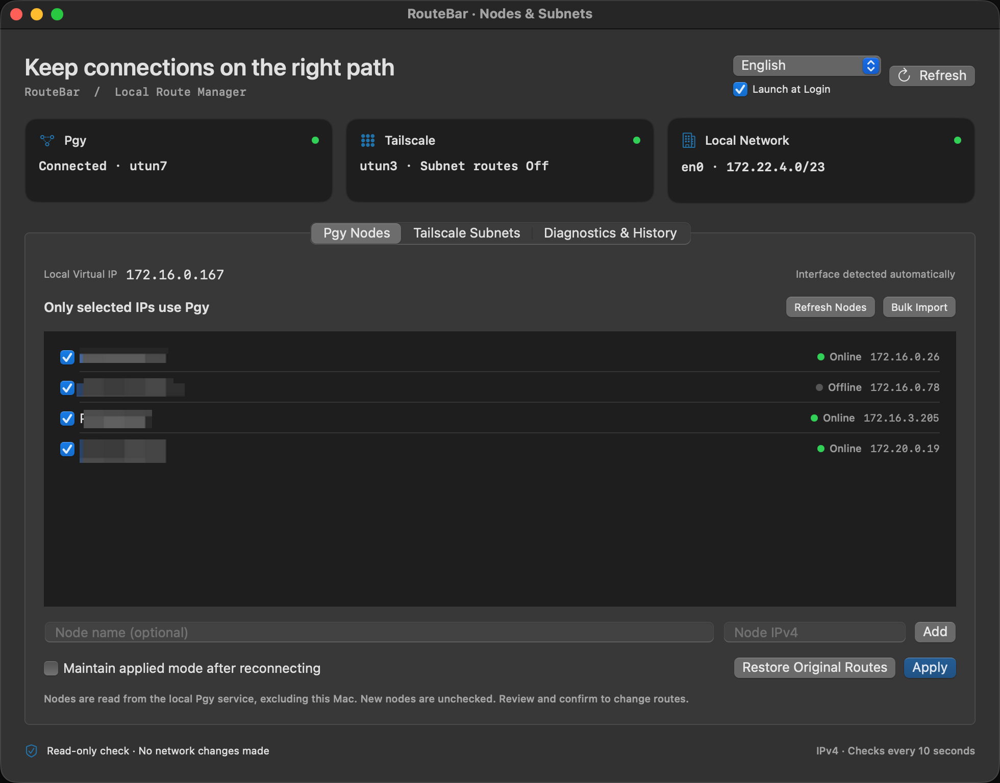
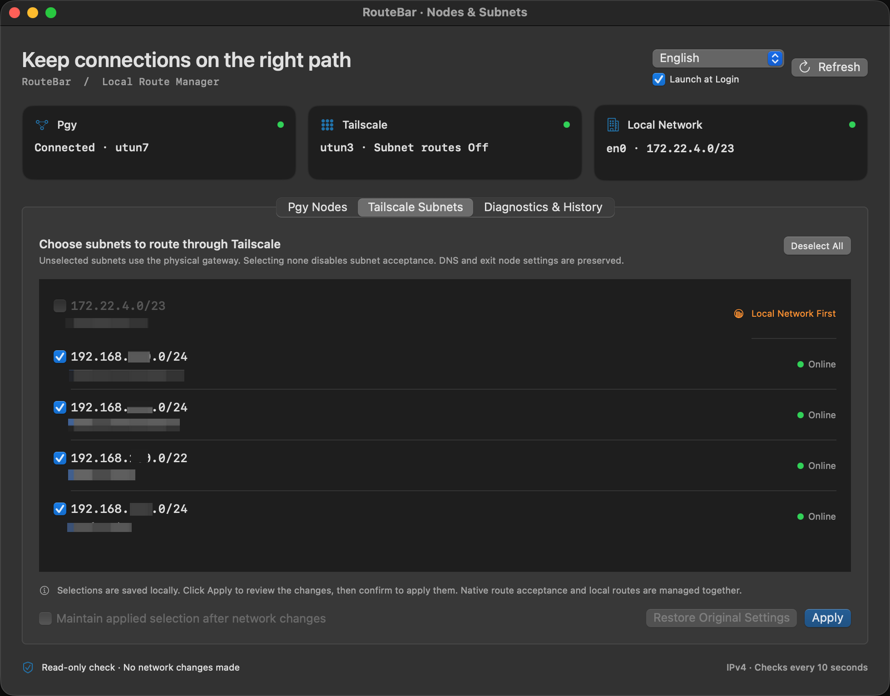

# RouteBar

A native macOS menu bar app for choosing which Pgy VPN nodes and Tailscale subnets use your VPN routes, while keeping local LAN access in view.

一个原生 macOS 菜单栏路由工具：按节点选择蒲公英、按子网选择 Tailscale，先预览，再授权应用。

**macOS 14+ · Apple Silicon release · Swift / SwiftUI / AppKit · No third-party dependencies**

## Download / 安装

Download the DMG from [Releases](https://github.com/shaojiaqi/RouteBar/releases/latest), open it, and drag **RouteBar** into **Applications** before running it or enabling launch at login.

从 [Releases](https://github.com/shaojiaqi/RouteBar/releases/latest) 下载 DMG，将 RouteBar 拖入「应用程序」后启动。当前下载版仅支持 Apple Silicon。

The app uses an ad-hoc signature and is **not Apple-notarized**. macOS may block its first launch; see Apple's [instructions for opening apps from unidentified developers](https://support.apple.com/guide/mac-help/open-a-mac-app-from-an-unknown-developer-mh40616/mac). You can also build from source.

当前版本为本地 ad-hoc 签名，**尚未经过 Apple 公证**，首次打开可能被系统拦截；也可以自行从源码构建。

## Screenshots / 界面预览

**Pgy nodes / 蒲公英节点** — Select individual IPs to route through Pgy. 按节点选择需要走蒲公英的 IP，本机虚拟 IP 自动识别。



**Tailscale subnets / Tailscale 子网** — Choose remote subnets while keeping directly connected LANs first. 选择远端子网，与直连内网冲突的网段会显示「Local Network First」。



## Features / 功能

- **Pgy node selection:** discovers local virtual IP, member names, IPs, and online status. Only checked IPs receive node routes; manual node entry and import are available.
- **Tailscale subnet selection:** discovers approved IPv4 subnets and router status, and prevents selecting subnets that overlap the directly connected LAN.
- **Preview before applying:** checking a box only saves a draft. **Apply** opens a preview; **Confirm and Apply** requests administrator authorization and executes it.
- **Restore and recovery:** records owned routes, supports restoring original settings, and rolls back failed or interrupted operations.
- **Dynamic interfaces:** identifies tunnels by address rather than a fixed `utun` number.
- **Launch at login:** optional system login item; login launch shows only the menu bar icon. Manual launch opens the manager.
- **Three languages:** English, 繁體中文, 简体中文; immediate switching and system-language selection.
- **Unavailable state:** when Pgy is absent or stopped, controls show an unavailable state while saved nodes and selections are retained.

蒲公英本机虚拟 IP 为自动识别的只读信息，可以复制。节点与子网勾选仅保存草稿，不会立即修改网络。点击「应用」查看预览，再点击「确认并应用」并授权后执行。

## Usage / 使用

1. Connect the official VPN clients yourself. RouteBar does not start, sign in to, or connect VPN clients.
2. Select Pgy nodes or Tailscale subnets, click **Apply**, and review every planned change.
3. Confirm and authorize only when ready. A privileged helper runs per operation; no persistent root service is installed and administrator passwords are not stored.
4. Optionally enable maintenance of an applied selection. Checks run every 10 seconds; editing drafts pauses corresponding maintenance. Maintenance resets to off each time RouteBar launches.
5. Use the corresponding **Restore** button before uninstalling. Quitting RouteBar does **not** undo applied routes or Tailscale preferences.

关闭管理窗口后工具继续在菜单栏运行；右键菜单栏图标、再次打开 App 或按 **Cmd-1** 可打开管理窗口。「登录时启动」位于管理窗口右上角及菜单栏浮窗，默认关闭；系统要求批准时会提供设置入口。移动 App 后可能需要重新启用登录项。

## Routing behavior and limits / 路由行为与限制

### Pgy / 蒲公英

RouteBar adds selected node `/32` routes before removing the verified original broad subnet route on the same tunnel. Restore reinstates the original subnet routes before removing routes created by RouteBar. Existing routes are not claimed as owned.

Node discovery uses a **private local client protocol** at loopback port 16604. It reads the service catalog and `GetGrpMbrs` only; it does not send credentials, configuration, or connection commands. Vendor updates may break discovery. Reads are bounded to 3 seconds and 2 MiB; failure retains the saved list. See [protocol notes](docs/pgy-discovery-evidence.md).

### Tailscale

Tailscale's native `--accept-routes` setting is a global switch, not a per-subnet selector. RouteBar combines this switch with local IPv4 routes:

- **None selected:** disables native subnet-route acceptance without adding bypass routes.
- **Some selected:** routes selected subnets to Tailscale and places more specific routes for unselected subnets through the physical default gateway. Directly connected networks use their physical interface. Unselected subnets can therefore bypass other proxies, and may be unreachable through the physical gateway.
- DNS, exit-node, login, and connection settings are preserved. Website-specific exit-node routing is not implemented.
- Overlapping advertised subnets must be selected or disabled together. Conflicting routes that cannot safely be handled cause planning to stop.
- IPv6 subnet selection is unsupported. If IPv6 advertisements are detected, enabling subnet reception is rejected; disabling all subnet reception remains available.

**This is route preference management, not firewall isolation.** Network changes and new subnet advertisements can take up to a polling interval to detect. When maintenance is paused or the app is stopped, the native global switch may still accept newly advertised subnets. Other VPN or proxy software, including Clash TUN, can install competing routes; RouteBar does not automatically configure Clash.

这是本机路由偏好管理，不是网络隔离。未选子网可能绕过其他代理走物理网关；网关不一定能访问这些远端子网。退出工具不会撤销路由，其他 VPN/代理仍可能改写路由。维护与恢复需要管理员授权，可能出现系统授权提示。

References: [Tailscale CLI](https://tailscale.com/docs/reference/tailscale-cli) · [Route injection](https://tailscale.com/docs/reference/route-injection)

## Execution and local data / 执行与本机数据

The helper re-reads the network state and rebuilds the plan after authorization. If it differs from the preview, no changes are made. Each mutation is journaled first, then verified; failures roll back in reverse order. Interface identity includes its address to avoid modifying another tunnel after interface-number reuse. External route conflicts are not overwritten.

- `~/Library/Application Support/RouteBar/settings.json`: saved node/subnet drafts.
- `~/Library/Application Support/RouteBar/activity.json`: recent operation history.
- `~/Library/Application Support/RouteBar/lifecycle.log`: local lifecycle diagnostics.
- `/var/db/io.routebar/session-<uid>.json`: root-owned recovery journal containing managed routes and prior route-acceptance settings, without passwords or keys.

Restore settings before deleting the app or its recovery journal. Routes are system-wide; this version is intended for one logged-in user. Inspection output and local journals contain network details: review them before sharing.

## Build / 构建

Requires macOS 14+ and Xcode or compatible Swift development tools.

```sh
swift test
bash scripts/build-app.sh
bash scripts/build-dmg.sh
```

Output: `dist/RouteBar.app`, `dist/routebarctl`, and a versioned DMG with SHA-256 checksum. Build architecture follows the host; the published DMG is arm64.

The CLI is read-only:

```sh
dist/routebarctl inspect
dist/routebarctl plan applyTailscale
# Example subnet; replace with one advertised by your own network.
dist/routebarctl plan applyTailscale --select 10.50.0.0/24
```

## Validation / 验证

Version 0.2.1 (build 8): 52 automated tests cover parsing, tunnel identity, route planning, ownership, conflicts, rollback/recovery, installation detection, and localization. Release builds, bundle signatures, DMG integrity, and the mounted app have been checked. Tests use synthetic network data and do not modify live routes.

UI checks covered the three languages, Apply preview/cancel, the read-only virtual IP, and login-item control visibility. Version 0.2.1 was also verified by applying a single Tailscale subnet on macOS: the selected subnet resolved through Tailscale, excluded subnets through the physical gateway, and the directly connected LAN retained its physical interface. This verifies local routing, not reachability of every remote device. Actual launch at the next macOS login has not been verified. Automated tests do not establish compatibility with every VPN/proxy version or network topology.

## License

[MIT](LICENSE). RouteBar is an independent project and is not affiliated with Oray/Pgy or Tailscale.

## Changes in 0.2.1

Fixed false rollback when applying Tailscale subnet selection. On macOS, `route get` can interpret a destination ending in `.0` as a network query and report the native subnet route instead of the more specific selection route. Verification now uses explicit `route get -host` lookups for all probe addresses, with deterministic probe order. Actual interface mismatches still trigger rollback, and the error now includes both expected and actual interfaces.

修复 Tailscale 子网选择被错误回滚：验证 `.0` 地址时明确按主机地址查询，避免 macOS 将其视为网段查询而误判。真实的接口不匹配仍会回滚，并显示预期与实际接口。
